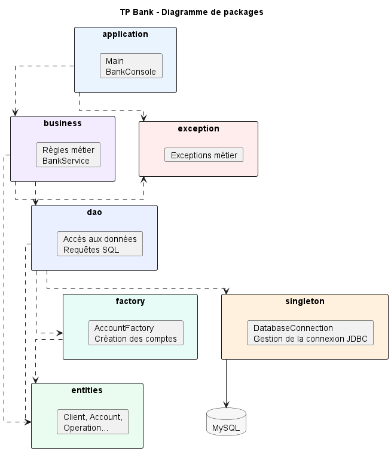
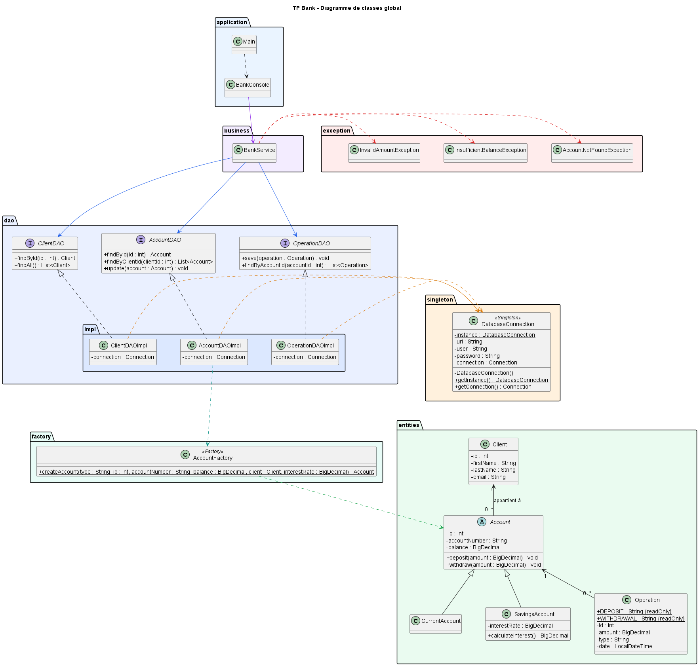

# TP Bank – Java et Design Patterns

## Présentation du projet

Ce projet a été réalisé dans le cadre de la formation Concepteur Développeur d'Applications, lors du module consacré aux design patterns en Java.

L'objectif est de concevoir une application bancaire en mode console permettant de gérer des clients, leurs comptes bancaires et les opérations associées.

Une attention particulière est portée à la conception orientée objet, à la séparation des responsabilités et à l'utilisation de design patterns.

## Fonctionnalités prévues

- Affichage de la liste des clients.
- Consultation des comptes bancaires d'un client.
- Gestion des comptes courants et des comptes épargne.
- Calcul des intérêts d'un compte épargne.
- Réalisation de dépôts et de retraits.
- Vérification du solde disponible avant un retrait.
- Enregistrement et consultation de l'historique des opérations.
- Gestion des erreurs et des exceptions métier.

## Technologies et outils utilisés

- Java
- JDBC
- MySQL
- Eclipse
- PlantUML
- WinP
- phpMyAdmin
- Git et GitHub

## Organisation du projet

```text
TPBank/
├── appli/
│   ├── src/
│   │   ├── application/
│   │   ├── business/
│   │   ├── dao/
│   │   │   └── impl/
│   │   ├── entities/
│   │   ├── exception/
│   │   ├── factory/
│   │   └── singleton/
│   └── lib/
├── bdd/
├── doc/
└── README.md
```

## Architecture

Le projet repose sur une architecture organisée en différentes couches afin de séparer les responsabilités.

| Package | Responsabilité |
| --- | --- |
| `application` | Point d'entrée et interface utilisateur en mode console |
| `business` | Gestion des règles métier |
| `entities` | Représentation des objets métier |
| `dao` | Définition des contrats d'accès aux données |
| `dao.impl` | Implémentation des accès à la base de données avec JDBC |
| `singleton` | Gestion de la connexion à la base de données |
| `factory` | Création des différents types de comptes |
| `exception` | Gestion des exceptions métier |

Cette séparation permet de faciliter la maintenance du code et d'envisager une évolution ultérieure vers une autre interface utilisateur.

## Conception UML

La conception de l'application a été réalisée avec PlantUML.

### Diagramme de packages



### Diagramme de classes global



Les fichiers sources PlantUML sont également disponibles dans le dossier `doc`.

Les diagrammes ont évolué au cours du développement, notamment lors de la séparation des interfaces DAO et de leurs implémentations.

## Design patterns

### Singleton

La classe `DatabaseConnection` permet de centraliser la gestion de la connexion JDBC à MySQL.

Le pattern repose sur :

- Un attribut statique conservant l'instance unique.
- Un constructeur privé empêchant l'instanciation directe depuis une autre classe.
- Une méthode statique `getInstance()` permettant d'accéder à l'instance.
- Une méthode `getConnection()` retournant la connexion JDBC.

L'instance est créée uniquement lors du premier appel à `getInstance()`.

Le fonctionnement du Singleton et la validité de la connexion à MySQL ont été testés.

### Factory

La classe `AccountFactory` centralise la création des différents types de comptes bancaires.

La méthode statique `createAccount()` instancie :

- Un objet `CurrentAccount` pour le type `CURRENT`.
- Un objet `SavingsAccount` pour le type `SAVINGS`.

Les deux classes héritent de la classe abstraite `Account`, utilisée comme type de retour de la méthode.

Cette approche permet d'exploiter le polymorphisme et d'éviter de répéter la logique d'instanciation dans les DAO.

La Factory crée uniquement des objets Java en mémoire. La persistance des données reste de la responsabilité des DAO.

La création des deux types de comptes ainsi que le calcul des intérêts ont été testés.

### DAO – Data Access Object

Le pattern DAO permet de séparer les accès à la base de données des règles métier.

La conception distingue :

- Les interfaces DAO, qui définissent les opérations disponibles.
- Les classes d'implémentation, qui contiennent les requêtes SQL et utilisent JDBC.

L'interface `ClientDAO` et son implémentation `ClientDAOImpl` permettent actuellement :

- De récupérer un client par son identifiant avec `findById()`.
- De récupérer la liste de tous les clients avec `findAll()`.

Les accès aux données utilisent notamment :

- `Connection` : connexion à la base de données.
- `PreparedStatement` : préparation et paramétrage des requêtes SQL.
- `ResultSet` : récupération des résultats.
- `try-with-resources` : fermeture automatique des ressources JDBC utilisées lors des requêtes.

Les deux méthodes ont été testées avec les données réellement présentes dans MySQL.

## Choix techniques

- Utilisation de `BigDecimal` pour représenter les montants bancaires et les taux d'intérêt, afin d'éviter les imprécisions liées aux nombres à virgule flottante.
- Utilisation de `LocalDateTime` pour représenter la date et l'heure des opérations.
- Utilisation d'une classe abstraite `Account` pour mutualiser les attributs et les comportements communs aux différents types de comptes.
- Utilisation d'interfaces pour les DAO afin de distinguer les contrats d'accès aux données de leurs implémentations.
- Externalisation des paramètres de connexion à la base de données à l'aide de variables d'environnement.
- Utilisation d'un utilisateur MySQL dédié disposant de droits limités sur la base de données du projet.

## Installation et configuration

### Base de données

1. Démarrer le serveur MySQL.
2. Importer le script SQL disponible dans le dossier `bdd`.
3. Créer un utilisateur MySQL dédié à l'application.
4. Attribuer à cet utilisateur les droits nécessaires sur la base `tp_bank` : `SELECT`, `INSERT` et `UPDATE`.

### Pilote JDBC

Télécharger MySQL Connector/J, version 26.10.0.

Placer le fichier JAR dans le dossier `appli/lib` et l'ajouter au Build Path du projet Eclipse.

Le pilote JDBC n'est pas versionné dans le dépôt Git.

### Variables d'environnement

Dans Eclipse, ouvrir :

**Run Configurations → Environment**

Renseigner les variables d'environnement suivantes :

| Variable | Valeur |
| --- | --- |
| `DB_URL` | `jdbc:mysql://localhost:3306/tp_bank` |
| `DB_USER` | Nom de l'utilisateur MySQL dédié |
| `DB_PASSWORD` | Mot de passe de l'utilisateur MySQL |

Les identifiants de connexion ne sont pas inscrits directement dans le code source.

### Exécution

Lancer la classe `application.Main` depuis Eclipse.

À ce stade, cette classe contient les tests permettant de vérifier :

- La connexion à MySQL.
- L'unicité de l'instance du Singleton.
- La création des différents types de comptes avec la Factory.
- Le calcul des intérêts d'un compte épargne.
- La récupération des clients depuis la base de données.

## État d'avancement

> Le projet est actuellement partiellement implémenté.
> La conception UML et les premiers design patterns ont été réalisés et testés.

### Travail réalisé

- [x] Diagramme de packages
- [x] Diagramme de classes global
- [x] Création du script SQL et de la base MySQL
- [x] Configuration de JDBC
- [x] Configuration des variables d'environnement
- [x] Implémentation des entités
- [x] Implémentation et validation du Singleton
- [x] Implémentation et validation de la Factory
- [x] Séparation des interfaces DAO et de leurs implémentations dans la conception UML
- [x] Création de l'interface `ClientDAO`
- [x] Implémentation de `ClientDAOImpl`
- [x] Test de récupération des clients depuis MySQL

### Travail restant

- [ ] Implémentation de `AccountDAO` et `AccountDAOImpl`
- [ ] Implémentation de `OperationDAO` et `OperationDAOImpl`
- [ ] Implémentation des exceptions personnalisées
- [ ] Implémentation des règles métier dans `BankService`
- [ ] Gestion des transactions SQL pour garantir la cohérence entre la modification du solde et l'enregistrement des opérations
- [ ] Implémentation de l'interface console `BankConsole`
- [ ] Validation complète des fonctionnalités
- [ ] Mise à jour finale des diagrammes UML

## Perspectives d'évolution

L'architecture pourrait être complétée par une interface web ou mobile, tout en conservant la séparation entre les couches métier et d'accès aux données.

